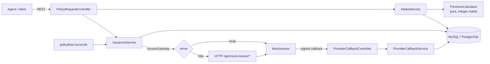
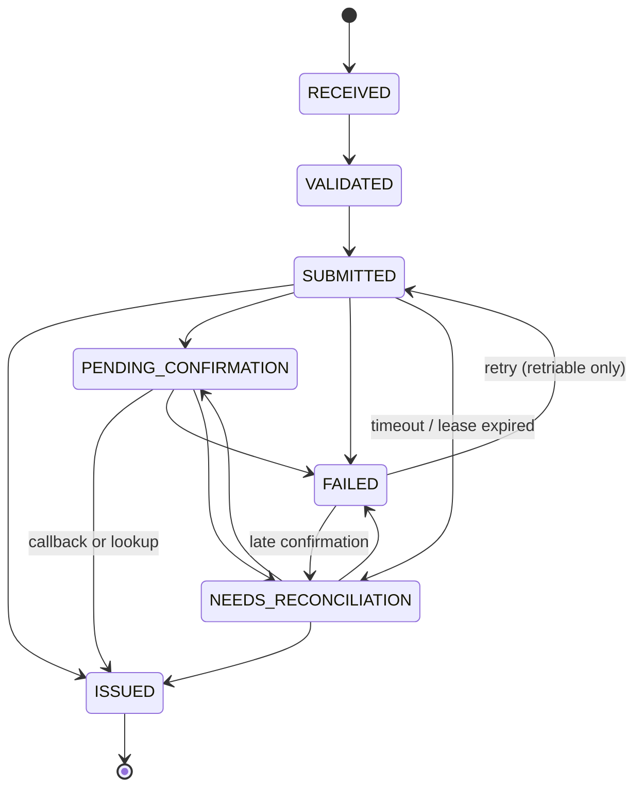

# PolicyFlow

**Author:** Rohan Raj  
**College:** Lovely Professional University  
**Registration number:** 12325337

Fault-tolerant travel-insurance issuance and reconciliation engine, built for the
TrippersShield campus engineering challenge.

Agents submit policy requests. PolicyFlow validates and prices them, submits them to an
unreliable (simulated) insurer, and tracks each one to a final outcome, without ever
issuing twice or landing in a wrong final state when requests are retried, time out or
are delivered more than once.

- **Stack:** PHP 8.2+, Laravel 12, MySQL 8 (PostgreSQL also works), PHPUnit 11
- **Reliability cases implemented:** all four from the brief (duplicate intake, timeout after
  success, duplicate callback, retry after temporary failure), each with automated tests
- **Extras:** reconciliation command for stale requests, signed callbacks, parallel-intake load script

---

## Contents

1. [Local setup](#1-local-setup)
2. [Running the tests](#2-running-the-tests)
3. [API](#3-api)
4. [Mock insurer](#4-mock-insurer)
5. [Architecture](#5-architecture)
6. [Duplicate prevention, transactions and concurrency](#6-duplicate-prevention-transactions-and-concurrency)
7. [Reliability cases](#7-reliability-cases)
8. [Assumptions](#8-assumptions)
9. [Known limitations](#9-known-limitations)
10. [Project layout](#10-project-layout)

---

## 1. Local setup

### Prerequisites

| Tool | Version | Notes |
|---|---|---|
| PHP | 8.2 or newer | Extensions: `pdo_mysql` (or `pdo_pgsql`), `pdo_sqlite` (tests), `mbstring`, `openssl`, `curl`, `fileinfo` |
| Composer | 2.x | |
| MySQL | 8.x | Or PostgreSQL 14+ |

On Windows with XAMPP/Laragon, make sure `extension=fileinfo`, `extension=pdo_sqlite` and
`extension=sqlite3` are enabled in `php.ini`, otherwise `composer install` or the tests fail.

### Steps

```bash
git clone <repo-url> policyflow
cd policyflow
composer install
cp .env.example .env            # Windows PowerShell: Copy-Item .env.example .env
php artisan key:generate
```

Create the database (MySQL shown):

```sql
CREATE DATABASE policyflow CHARACTER SET utf8mb4 COLLATE utf8mb4_unicode_ci;
```

Set `DB_USERNAME` / `DB_PASSWORD` in `.env` if your MySQL user is not `root` with an empty password,
then:

```bash
php artisan migrate
php artisan serve               # http://127.0.0.1:8000
```

PostgreSQL instead of MySQL: set `DB_CONNECTION=pgsql` and `DB_PORT=5432` in `.env`.

Quick try without a database server: set `DB_CONNECTION=sqlite`, remove the other `DB_*` lines,
create an empty file `database/database.sqlite`, then `php artisan migrate`.

### Walkthrough script

With the server running, in a second terminal:

```bash
bash examples/demo.sh                                              # Linux / macOS / Git Bash
powershell -ExecutionPolicy Bypass -File examples\demo.ps1         # Windows
```

It creates requests, repeats them, triggers validation errors and runs the SUCCESS,
TIMEOUT_AFTER_ISSUE, TEMPORARY_FAILURE and DUPLICATE_CALLBACK scenarios. It is safe to run
repeatedly. `examples/http/policyflow.http` has the same calls for the VS Code REST Client /
PhpStorm, and `examples/requests/` holds every JSON payload.

### Useful commands

| Command | What it does |
|---|---|
| `php artisan policyflow:reconcile` | Status-lookup for NEEDS_RECONCILIATION, PENDING_CONFIRMATION older than 15 min and SUBMITTED past its lease |
| `php artisan mock-insurer:deliver-callbacks [--http]` | Mock insurer confirms pending policies and sends their callbacks |
| `php artisan mock-insurer:sign '<json>'` | Prints the signature header for a hand-written callback |
| `php artisan schedule:work` | Runs the reconciler every 5 minutes |
| `php artisan db:seed` | Optional: one VALIDATED demo request per mock scenario |

---

## 2. Running the tests

```bash
php artisan test
```

Tests use an in-memory SQLite database (configured in `phpunit.xml`), so no database server
is needed. They cover:

| Area | Test file |
|---|---|
| Premium formula, age bands, rounding | `tests/Unit/PremiumCalculatorTest.php` |
| State machine regressions (e.g. ISSUED -> SUBMITTED) | `tests/Unit/PolicyStatusTest.php` |
| Insurer response classification | `tests/Unit/InsurerResponseMapperTest.php` |
| Validation, premium, idempotent intake, DB-level uniqueness, race path | `tests/Feature/PolicyRequestIntakeTest.php` |
| List filter + pagination | `tests/Feature/PolicyRequestListTest.php` |
| One policy number on success, repeated submit, callback cannot overwrite ISSUED | `tests/Feature/IssuanceSuccessTest.php` |
| Timeout after issue (and timeout before issue, failing lookup) | `tests/Feature/TimeoutAfterIssueTest.php` |
| Duplicate callback, bad signature, unmatched, callback overtaking our own write | `tests/Feature/DuplicateCallbackTest.php` |
| Delayed callback, late insurer response cannot regress ISSUED | `tests/Feature/DelayedCallbackTest.php` |
| Retry after temporary failure, retry limit, permanent decline | `tests/Feature/RetryAfterTemporaryFailureTest.php` |
| In-flight 409, abandoned submission recovery | `tests/Feature/ConcurrencyAndStateGuardsTest.php` |
| Reconcile command | `tests/Feature/ReconcileCommandTest.php` |
| Mock insurer HTTP endpoints, HTTP gateway mapping | `tests/Feature/MockInsurerEndpointsTest.php` |

### Continuous integration

`.github/workflows/tests.yml` runs the full suite on SQLite, MySQL 8 and PostgreSQL 16 on
every push, so the row-locking paths are exercised on real databases too.

### Running the tests on MySQL

SQLite does not have row locks, so it is worth running the suite against MySQL as well.
Create an empty `policyflow_test` database, then:

```bash
DB_CONNECTION=mysql DB_DATABASE=policyflow_test php artisan test
```

```powershell
$env:DB_CONNECTION="mysql"; $env:DB_DATABASE="policyflow_test"; php artisan test
```

### Parallel intake (load) check

```bash
PHP_CLI_SERVER_WORKERS=8 php artisan serve        # needs a multi-worker server
php examples/concurrency/parallel_intake.php 100  # 100 identical POSTs at once
```

Expected: exactly one `HTTP 201`, the rest `HTTP 200`, one distinct id, one row in the
database. `PHP_CLI_SERVER_WORKERS` does not work on Windows; there, use WSL/Docker or a real
web server (Apache/Nginx + PHP-FPM). With a single-worker server the requests are serialised,
which still shows the replay behaviour but not the race.

---

## 3. API

Base URL: `http://127.0.0.1:8000/api`. Send `Accept: application/json` and
`Content-Type: application/json`.

### Response envelope

Every response uses one of two shapes:

```jsonc
// success
{ "data": { ... }, "meta": { ... } }          // meta only when there is something to say

// error
{ "error": { "code": "VALIDATION_FAILED", "message": "...", "details": { ... } } }
```

| HTTP | `error.code` | When |
|---|---|---|
| 422 | `VALIDATION_FAILED` | Bad input; `details.fields` maps field -> messages |
| 404 | `NOT_FOUND` | Unknown id (ids are UUIDs) |
| 409 | `IDEMPOTENCY_KEY_REUSED` | Same `agent_id` + `client_request_id`, different payload |
| 409 | `SUBMISSION_IN_PROGRESS` | Another submit for the same request is still running |
| 409 | `RETRY_LIMIT_REACHED` | `ISSUANCE_MAX_ATTEMPTS` (default 3) used up |
| 409 | `ISSUANCE_FAILED_PERMANENTLY` | Insurer declined; cannot be retried |
| 409 | `INVALID_STATE_TRANSITION` | A transition the state machine forbids |
| 401 | `INVALID_SIGNATURE` | Callback signature missing or wrong |
| 500 | `INTERNAL_ERROR` | Unexpected error (no internals leaked unless `APP_DEBUG=true`) |

### Endpoints

| Method | Path | Success codes |
|---|---|---|
| POST | `/policy-requests` | 201 created, 200 safely repeated |
| GET | `/policy-requests/{id}` | 200 |
| POST | `/policy-requests/{id}/submit` | 200 ISSUED, 202 pending/reconciling, 502 insurer failure |
| POST | `/mock-insurer/callback` | 200 processed (incl. duplicates), 202 unmatched |
| GET | `/policy-requests?status=&agent_id=&per_page=&page=` | 200 |

#### POST /policy-requests

```bash
curl -s -X POST http://127.0.0.1:8000/api/policy-requests \
  -H "Accept: application/json" -H "Content-Type: application/json" \
  --data @examples/requests/create-example.json
```

| Field | Rules |
|---|---|
| `client_request_id`, `agent_id` | required, max 64, `[A-Za-z0-9._:-]` |
| `customer_name` | required, 2-120 chars |
| `date_of_birth` | required, `Y-m-d`, not in the future, on or before `trip_start` |
| `destination` | `DOMESTIC` or `INTERNATIONAL` (case-insensitive) |
| `trip_start`, `trip_end` | required, `Y-m-d`, `trip_end >= trip_start`, at most 365 days inclusive |
| `plan_code` | `BASIC`, `PLUS` or `PREMIUM` (case-insensitive) |
| `sum_insured` | `100000`, `300000` or `500000` |
| `mock_scenario` | optional, development only (see section 4); rejected when the mock is disabled |

Response `201` (or `200` with `meta.idempotent_replay: true` and header
`Idempotent-Replayed: true` for a repeat):

```json
{
  "data": {
    "id": "9d3f6a2e-8b7c-4f1e-a2d4-5c6b7a8e9f01",
    "agent_id": "AGENT-17",
    "client_request_id": "AGT-2026-0001",
    "status": "VALIDATED",
    "customer_name": "Sample Customer",
    "date_of_birth": "1998-04-10",
    "destination": "INTERNATIONAL",
    "trip_start": "2026-11-10",
    "trip_end": "2026-11-14",
    "plan_code": "PLUS",
    "sum_insured": 300000,
    "premium": {
      "amount": "225.00",
      "currency": "INR",
      "travel_days": 5,
      "age_at_trip_start": 28,
      "breakdown": {
        "currency": "INR",
        "formula": "base_daily_rate x travel_days x age_multiplier x destination_multiplier x coverage_multiplier",
        "plan_code": "PLUS",
        "base_daily_rate": "20.00",
        "travel_days": 5,
        "age_at_trip_start": 28,
        "age_multiplier": "1.00",
        "destination": "INTERNATIONAL",
        "destination_multiplier": "1.80",
        "sum_insured": 300000,
        "coverage_multiplier": "1.25",
        "premium": "225.00"
      }
    },
    "provider_reference": null,
    "policy_number": null,
    "attempt_count": 0,
    "failure": null,
    "mock_scenario": "SUCCESS",
    "submitted_at": null,
    "issued_at": null,
    "created_at": "2026-10-24T10:15:02+00:00",
    "updated_at": "2026-10-24T10:15:02+00:00",
    "last_response": null,
    "audit_trail": [
      { "from": null, "to": "RECEIVED", "actor": "api", "reason": "Policy request received", "context": null, "at": "..." },
      { "from": "RECEIVED", "to": "VALIDATED", "actor": "api", "reason": "Validated and premium calculated", "context": { "premium": "225.00", "travel_days": 5 }, "at": "..." }
    ],
    "issuance_attempts": [],
    "provider_events": []
  },
  "meta": { "idempotent_replay": false }
}
```

Money is always a string with two decimals (`"225.00"`), never a float.

#### GET /policy-requests/{id}

Same `data` object as above: current state, premium and breakdown, `provider_reference`,
`policy_number`, last insurer response, the full `audit_trail`, every `issuance_attempts`
row (issue calls and status lookups) and every `provider_events` row.

#### POST /policy-requests/{id}/submit

Starts issuance, or safely resumes it. What happens depends on the current state:

| Current state | Effect | Insurer called? | HTTP |
|---|---|---|---|
| VALIDATED | SUBMITTED, issue call | yes | per outcome |
| FAILED (retriable, attempts left) | retry with the same key and premium | yes | per outcome |
| NEEDS_RECONCILIATION | status lookup only | lookup only | per outcome |
| SUBMITTED, lease active | rejected | no | 409 `SUBMISSION_IN_PROGRESS` |
| SUBMITTED, lease expired | treated as unknown, status lookup | lookup only | per outcome |
| PENDING_CONFIRMATION | nothing, returns state | no | 202 |
| ISSUED | nothing, returns state | no | 200 |
| FAILED (declined / limit reached) | rejected | no | 409 |

Outcome codes: `200` ISSUED; `202` PENDING_CONFIRMATION or NEEDS_RECONCILIATION; `502` FAILED
(the insurer failed; `meta.retriable` says whether submitting again is allowed). The body is
the usual `data` object plus:

```json
"meta": { "provider_calls": 1, "note": "Policy issued.", "retriable": null }
```

`provider_calls` is how many insurer calls this HTTP request caused. A repeated submit on an
issued or pending request always shows `0`.

#### POST /mock-insurer/callback

The insurer's webhook into PolicyFlow. Body:

```json
{
  "event_id": "evt_9f2c...",
  "event_type": "POLICY_ISSUED",
  "provider_reference": "MIR-1A2B3C4D5E6F7A8B",
  "client_reference": "9d3f6a2e-8b7c-4f1e-a2d4-5c6b7a8e9f01",
  "policy_number": "TSP-2026-0000001",
  "occurred_at": "2026-10-24T10:16:00+00:00"
}
```

`event_type` is `POLICY_ISSUED` or `POLICY_DECLINED` (`policy_number` required for issued,
optional `reason` for declined). At least one of `provider_reference` / `client_reference` is
required. The request must carry `X-Insurer-Signature: sha256=<hex HMAC-SHA256 of the raw body
with MOCK_INSURER_WEBHOOK_SECRET>`. To send one by hand:

```bash
BODY='{"event_id":"evt-manual-1","event_type":"POLICY_ISSUED","client_reference":"<id>","policy_number":"TSP-2026-9000001"}'
php artisan mock-insurer:sign "$BODY"      # prints the header line
curl -s -X POST http://127.0.0.1:8000/api/mock-insurer/callback \
  -H "Content-Type: application/json" -H "Accept: application/json" \
  -H "X-Insurer-Signature: sha256=<value printed above>" --data "$BODY"
```

Response: `{"data": {"event_id": "...", "result": "APPLIED", "note": "...", "policy_request_id": "...", "policy_request_status": "ISSUED", "policy_number": "..."}}`.

| `result` | Meaning |
|---|---|
| `APPLIED` | State changed (ISSUED or FAILED) |
| `DUPLICATE_IGNORED` | This `event_id` was already processed; nothing done |
| `NO_CHANGE` | New event id, but it says what we already know |
| `CONFLICT_IGNORED` | Contradicts a confirmed state (e.g. different policy number for an ISSUED request); not applied |
| `ESCALATED` | Confirmation for a request we had marked FAILED; moved to NEEDS_RECONCILIATION |
| `UNMATCHED` | No request matches; stored for investigation (HTTP 202) |

#### GET /policy-requests

`?status=ISSUED&agent_id=AGENT-17&per_page=20&page=1` (`per_page` 1-100, default 20, newest
first). Returns `data` as a list of summaries (no audit trail) and:

```json
"meta": { "current_page": 1, "per_page": 20, "total": 3, "last_page": 1, "filters": { "status": "ISSUED" } }
```

---

## 4. Mock insurer

The simulated insurer lives in `app/Services/MockInsurer/MockInsurer.php` with its own
table, `mock_insurer_policies` (its "policy book"). Like a real insurer that supports
idempotency keys, once a key is ISSUED every later issue call returns the same policy.
The scenario only decides how it behaves on the way there.

| Scenario | First issue call | Later issue calls | PolicyFlow handling |
|---|---|---|---|
| `SUCCESS` | creates policy, 201 ISSUED | 200, same policy | ISSUED exactly once |
| `TEMPORARY_FAILURE` | 503 for the first `MOCK_INSURER_TEMPORARY_FAILURES` calls (default 1) | then 201 | FAILED (retriable); retry with the same key/premium |
| `TIMEOUT_AFTER_ISSUE` | creates policy, then 504 (caller gets no answer) | 200, same policy | NEEDS_RECONCILIATION -> status lookup -> ISSUED; no second issue call |
| `TIMEOUT_BEFORE_ISSUE` (added) | 504, nothing created | 201 | lookup says NOT_FOUND -> FAILED (retriable) -> retry issues |
| `DELAYED_CALLBACK` | 202 PENDING | 202 | PENDING_CONFIRMATION until the callback arrives |
| `DUPLICATE_CALLBACK` | 202 PENDING | 202 | identical callback sent `MOCK_INSURER_DUPLICATE_DELIVERIES` times (default 3); applied once |
| `PERMANENT_FAILURE` (added) | 422 DECLINED | 422 | FAILED, not retriable |

Choosing a scenario: pass `"mock_scenario"` when creating the request (stored with it, so it
is deterministic per request), or set `MOCK_INSURER_DEFAULT_SCENARIO` in `.env`. The mock and
the `mock_scenario` field are disabled automatically when `APP_ENV=production`.

Delayed and duplicate callbacks are sent when you trigger them, which makes the "later" part
deterministic:

```bash
php artisan mock-insurer:deliver-callbacks             # in-process
php artisan mock-insurer:deliver-callbacks --http      # real HTTP POSTs to APP_URL
curl -X POST http://127.0.0.1:8000/api/mock-insurer/deliver-callbacks   # same, via API
```

The mock's own HTTP endpoints (development only):

| Method | Path | Purpose |
|---|---|---|
| POST | `/api/mock-insurer/policies` | Issue (body = PolicyFlow's issue payload, `Idempotency-Key` header or `idempotency_key` field) |
| GET | `/api/mock-insurer/policies/{idempotency_key}` | Provider status lookup: `ISSUED` / `PENDING` / `DECLINED`, or 404 `NOT_FOUND` |
| POST | `/api/mock-insurer/deliver-callbacks` | Send pending callbacks now |

**Gateway driver.** By default PolicyFlow calls the mock in-process (`INSURER_DRIVER=local`).
Both drivers go through the same response mapper, so the issuance code cannot tell them apart.
With `INSURER_DRIVER=http` it calls the endpoints above over HTTP instead; that needs a
server with more than one worker, because `php artisan serve` cannot answer a request to
itself while it is still handling the outer one.

**Changing behaviour during the interview.** Edit the `respond()` method in `MockInsurer.php`
(one `case` per scenario), change the `MOCK_INSURER_*` values in `.env`, or post a hand-signed
callback.

---

## 5. Architecture



| Layer | Where | Responsibility |
|---|---|---|
| HTTP | `app/Http` | Validation (`StorePolicyRequestRequest`), controllers, one JSON envelope (`ApiResponse`), `PolicyRequestPresenter` |
| Domain | `app/Domain/Pricing`, `app/Enums` | Pricing (no framework, no floats), state machine `PolicyStatus` |
| Services | `app/Services` | `IntakeService` (idempotent create), `IssuanceService` (submit / retry / reconcile), `ProviderCallbackService` (exactly-once callbacks) |
| Integration | `app/Services/Insurer` | `InsurerGateway` port, local and HTTP adapters, `InsurerResponseMapper` |
| Simulator | `app/Services/MockInsurer` | Deterministic insurer + callback dispatchers |

### State machine



The allowed transitions are a table in `app/Enums/PolicyStatus.php`.
`PolicyRequest::transitionTo()` refuses anything else (`INVALID_STATE_TRANSITION`) and writes
an audit row for every change. ISSUED has no outgoing transitions. I did not add new states;
retriable vs. permanent failure is a flag (`failure_retriable`) on FAILED.

### Data model

| Table | Purpose | Key constraints |
|---|---|---|
| `policy_requests` | One row per logical request; inputs, premium snapshot, current state, references | `UNIQUE(agent_id, client_request_id)`, `UNIQUE(uuid)`, `UNIQUE(policy_number)`, `UNIQUE(provider_reference)` |
| `policy_state_history` | Append-only audit trail (from, to, actor, reason, context) | FK to request |
| `issuance_attempts` | Every insurer call: kind (ISSUE / STATUS_LOOKUP), outcome, HTTP status, response, timings | `UNIQUE(policy_request_id, sequence)` |
| `provider_events` | Inbox of insurer callbacks and how each was handled | `UNIQUE(event_id)` |
| `mock_insurer_policies` | The simulator's own book (would be the insurer's database) | `UNIQUE(idempotency_key)`, `UNIQUE(policy_number)` |

### Pricing

`premium = base_daily_rate x travel_days x age_multiplier x destination_multiplier x coverage_multiplier`

Multipliers are stored as integer hundredths (`1.80` -> `180`), so the exact premium in paise
is `rate x 100 x days x age x dest x cov / 1,000,000`. That is computed with integers and
rounded half-up once, at the end. No floats are involved. Age is completed years on
`trip_start`. Days are inclusive (`end - start + 1`, minimum 1). The result and a breakdown
are stored on the request and never recomputed: the model throws if code tries to change the
premium or any business input after creation.

---

## 6. Duplicate prevention, transactions and concurrency

**Intake.** The database decides. `UNIQUE(agent_id, client_request_id)` is the real guard:

1. Look up the key; if it exists and the payload fingerprint (SHA-256 of the normalised
   business fields) matches, return it with `200`. Different payload -> `409`.
2. Otherwise INSERT inside a transaction. If two near-simultaneous requests both got past
   step 1, exactly one INSERT succeeds. The other gets a unique-constraint violation, which is
   caught *after* its transaction has rolled back (so this also works on PostgreSQL, which
   poisons a transaction after an error), and is answered with the winner's row (`200`).

**Submit.** Three short phases, so that no database lock is held during the network call:

1. *Decide* - `SELECT ... FOR UPDATE` on the request. Based on its state, either return
   without calling the insurer (ISSUED, PENDING_CONFIRMATION), reject (in-flight, declined,
   limit reached), reconcile, or move to SUBMITTED, record `submitted_at` (a lease) and an
   IN_FLIGHT attempt row, then commit. A concurrent submit now sees SUBMITTED and gets `409`.
2. *Call* the insurer with no lock held. The idempotency key is the request UUID, identical on
   every retry; the payload comes from the stored premium snapshot.
3. *Record* - lock the row again, store the attempt result, and transition only if the row is
   still in the SUBMITTED state this attempt created. If a callback resolved it in the
   meantime, the attempt is recorded and the state left alone.

**Unknown outcomes.** A timeout, a connection error, a 500/502/504 or an unreadable 2xx is
treated as "the insurer may have acted" (NEEDS_RECONCILIATION), never as a plain failure.
Only a status lookup can move such a request on: to ISSUED, PENDING_CONFIRMATION, FAILED
(declined), or FAILED-retriable when the insurer has no record of the key. Only that last
case allows a re-issue, and even then with the same key. A SUBMITTED request whose lease
(`ISSUANCE_SUBMISSION_LEASE_SECONDS`, default 120) has expired is handled the same way, which
covers a worker that crashed mid-call.

**Callbacks.** The `provider_events` INSERT (`UNIQUE(event_id)`) and the state change commit in
one transaction. A repeated delivery fails the INSERT, rolls back and is acknowledged as
`DUPLICATE_IGNORED`, including when two copies arrive at the same time (the second INSERT
waits on the index until the first commits). Because recording and applying are atomic, a
crash cannot leave an event "seen" but not applied. A confirmed ISSUED state is never
overwritten by a later event.

**Repeated HTTP requests never cause repeated provider calls**: every path that can call the
insurer first checks the state under a row lock, and `meta.provider_calls` makes that visible.

---

## 7. Reliability cases

All four cases from the brief are implemented and tested.

| Case | How it is handled | Tests |
|---|---|---|
| **Duplicate intake** (including near-simultaneous) | Unique index + catch-and-replay; payload fingerprint for conflicting reuse | `PolicyRequestIntakeTest::test_repeated_submission_...`, `test_losing_a_concurrent_insert_race_...`, `test_uniqueness_is_enforced_by_the_database_itself`, `test_reusing_a_key_with_a_different_payload_...`; load script `examples/concurrency/parallel_intake.php` |
| **Timeout after success** | Timeout -> NEEDS_RECONCILIATION -> status lookup -> ISSUED; never a blind re-issue; a failing lookup leaves it NEEDS_RECONCILIATION | `TimeoutAfterIssueTest` (3 tests), `ConcurrencyAndStateGuardsTest::test_abandoned_submission_...` |
| **Duplicate callback** | `UNIQUE(event_id)` inbox, record + apply in one transaction; HMAC signature | `DuplicateCallbackTest` (6 tests) |
| **Retry after temporary failure** | FAILED with `failure_retriable`; retry reuses the idempotency key and the stored premium; attempt limit | `RetryAfterTemporaryFailureTest` (4 tests) |

Also covered: a late insurer response cannot regress an ISSUED request
(`DelayedCallbackTest::test_late_insurer_response_cannot_regress_an_issued_request`) and a
callback cannot overwrite ISSUED (`IssuanceSuccessTest::test_a_callback_cannot_overwrite_...`).

**What would change in production:** run submits through a queue (retry with exponential
backoff and jitter, dead-letter after the attempt limit) instead of client-driven retries;
run `policyflow:reconcile` from the scheduler; add alerts on NEEDS_RECONCILIATION age and
`CONFLICT_IGNORED` / `UNMATCHED` events; authenticate agents and scope requests per agent.

---

## 8. Assumptions

- **Idempotency key scope** is `agent_id + client_request_id`. Reusing it with different data
  is a client bug and gets `409`, not a silent replay.
- **Past trip dates are accepted.** The brief only requires `trip_end >= trip_start`; a real
  product would also reject trips that have already started.
- **Maximum trip length is 365 days.** Not in the brief; it catches typos.
- **Age** is completed years on `trip_start`; a 29 February birthday counts from 1 March in
  non-leap years (PHP's default).
- **Retries are client-driven**: calling `submit` again is the retry. `ISSUANCE_MAX_ATTEMPTS`
  (default 3) counts issue calls, not status lookups.
- **The insurer is idempotent on our key** (the mock is). PolicyFlow still never relies on that
  alone: it reconciles before re-issuing.
- **HTTP 502 for an insurer failure on submit**, with the request in the body, because the
  failure is upstream and the client needs the current state to decide what to do.
- **Callbacks are matched** by `provider_reference`, or by `client_reference` (our UUID) when a
  callback arrives before we stored the provider reference.
- **No authentication** on the agent API (out of scope). The callback endpoint is
  authenticated with an HMAC signature.
- **Personal data:** customer name and date of birth are stored on the request and sent to the
  insurer. They are not written to logs, attempt rows, the audit trail or the mock's table.
  The mock gets `customer_name` because a real insurer would need it.

## 9. Known limitations

- **Tests run on SQLite by default**, which has no row locks (`lockForUpdate()` is a no-op
  there). The concurrency logic relies on MySQL/PostgreSQL locks and unique indexes; run the
  suite on MySQL (section 2) and the parallel intake script to exercise them.
- **True parallelism is not exercised in PHPUnit.** The race paths are tested by reproducing the
  losing side (an INSERT that hits the unique index, a callback arriving mid-call).
- **No queue workers.** Submissions are synchronous, so a slow insurer makes the client wait up
  to `INSURER_HTTP_TIMEOUT_SECONDS`.
- **The mock shares the application database**, purely to keep setup to one command.
- **The scheduler must be running** (`php artisan schedule:work`) for stale PENDING requests to
  be reconciled automatically; otherwise run `policyflow:reconcile` by hand.
- **No admin UI** (Filament was optional); everything is visible through the read endpoint.
- **Single currency (INR).**

## 10. Project layout

```
app/
  Console/Commands/      policyflow:reconcile, mock-insurer:deliver-callbacks, mock-insurer:sign
  Domain/Pricing/        PremiumCalculator, PricingTable, Money, PremiumQuote
  Enums/                 PolicyStatus (state machine), MockScenario, AttemptOutcome
  Exceptions/            Domain errors rendered as the JSON error envelope
  Http/                  Controllers, form request, presenter, ApiResponse, middleware
  Models/                PolicyRequest, PolicyStateHistory, IssuanceAttempt, ProviderEvent, MockInsurerPolicy
  Services/              IntakeService, IssuanceService
  Services/Insurer/      Gateway port, local + HTTP adapters, response mapper
  Services/Callbacks/    ProviderCallbackService, CallbackSigner
  Services/MockInsurer/  Simulated insurer and callback dispatchers
config/insurer.php       All reliability / mock settings
database/migrations/     Five tables
examples/                demo.sh, demo.ps1, JSON payloads, .http file, parallel intake script
tests/Unit, tests/Feature
```
